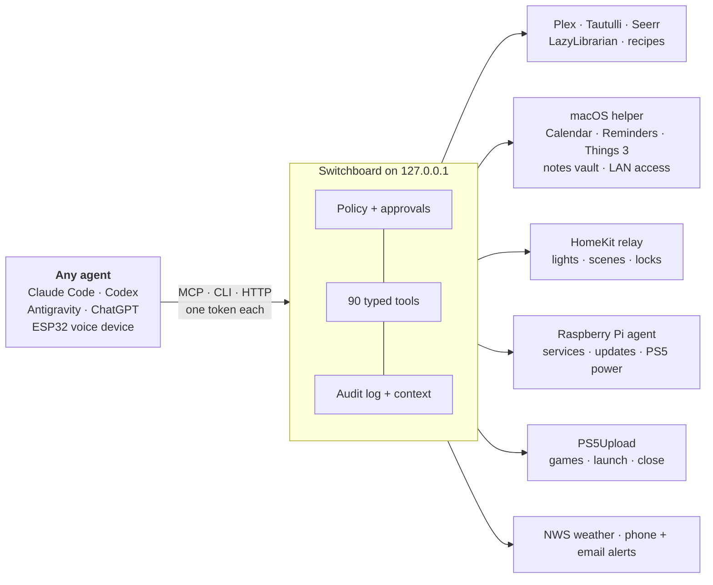

# Switchboard

**Agent harnesses come and go. Your home's tools, rules and context shouldn't have to.**

Switchboard is one local service that gives every AI agent you use the same hands in your house. Claude Code, Codex, a phone assistant and a little voice gadget on the counter can all check your servers, run your Plex library, dim the lights, move a Things to-do or wake the PS5. They all do it through the same 90 typed tools, under one policy file, with one audit log.

```text
"Is anything down?"                          → ops_health
"Turn on the PS5 and start Astro Bot"        → console_wake, console_games, console_launch
"Tell me when Dune: Part Two finishes"        → alerts_watch_add
"Push my dentist to-do to Friday"            → tasks_search, tasks_update
"What did the agents do overnight?"          → audit_digest
"Why did Sonarr restart at 3am?"             → audit_trace
"Something with chicken, under 30 minutes"   → recipes_search
```

MCP, a JSON CLI or HTTP on loopback. Python, plus a small signed macOS helper. MIT.

## The problem

If you run a home server and use AI agents, you almost certainly use more than one, and next month there'll be another. Each one wants its own way to reach your stuff, and each one has to be taught the house again:

- which Plex library is which, and which API key goes where;
- that requests go through Seerr, never straight to Sonarr;
- that the garage door needs a human's yes;
- that Nextcloud is slow because its files live on a USB disk, not because it's down.

That knowledge ends up spread across prompt files, MCP configs, shell history and one-off scripts. It drifts, it leaks credentials into places it shouldn't, and it's gone the day you switch tools. Meanwhile every agent improvises with `curl`, `docker logs` and `ssh`, redoes the same chores by hand, and has exactly as much power as your shell.

The harness is the part that changes fastest. Everything else should stay put: **what can be done, who may do it, what things are called, and what happened last time.** Switchboard is that layer.



## What it can do

Every integration is optional. Turn on the ones you run.

### Keep the servers alive · `ops_*` · 12 tools

- **Health and monitoring.** Health probes run every minute, and alerts go to your phone (ntfy) and email. Each probe can have its own timeout and failure threshold, so a slow USB-disk service doesn't page you at 2am. Silences end on their own when the service recovers.
- **A dead-man heartbeat** goes to a second machine, so you still hear about it when the whole server dies.
- **Logs, status, CPU, memory, swap and disk** for launchd jobs, Docker containers and apps, with secrets stripped from log lines.
- **Restarts of allowlisted services,** which silence their own alerts and enforce a cooldown.
- **A Raspberry Pi as a second host,** reached over SSH, where the key can only run a fixed command set: status, logs, DNS / Tailscale / uptime checks, allowlisted restarts and a package-list refresh. There's no shell and no reboot.

### Watch things · `media_*` · 17 tools

- Search and request movies and shows through Seerr, so requests keep your quality profiles and routing.
- "What should I watch?": unwatched picks, continue watching, what's playing now, who watched what (Tautulli), what just arrived.
- `media_show_detail` knows the difference between a season that has started airing and one that's only been announced.
- Downloads, library and storage health, and watched-state fixes (owner-confirmed).
- Per-title compression requests, handed to a separate maintenance worker that owns the encoder.

### Play · `console_*` · 6 tools

- Is the PS5 on, in rest mode or off? How hot is it, how full is the SSD, and what's running?
- Wake it and put it in rest mode, through Sony's own Remote Play protocol from the Pi on the same LAN.
- List installed games, then launch or close one through the PS5Upload engine. Only real store titles (CUSA/PPSA) can be launched, and its shell, files and payload routes are never exposed.

### Run the house · `home_*` · 6 tools

- Lights, accessories and scenes through a HomeKit relay app, such as [HomeRelay](https://github.com/shhish/HomeRelay).
- Locks, garage doors and other sensitive accessories are a separate allowlist. Every change to them needs an exact, single-use approval.

### Get things done · `tasks_*` `reminders_*` `calendar_*` · 19 tools

- **Things 3:** Today, Inbox, Upcoming, Anytime and search; add, edit (title, notes, when, deadline, project or area, tags) and complete.
- **Reminders:** due and overdue lists, add (timed or all-day), edit and complete.
- **Calendar:** upcoming events, conflicts, create and edit (one occurrence of a recurring event at a time). Events with other attendees are left to the Calendar app.
- Writes only go to the lists and projects your policy allows.

### Remember things · `notes_*` `recipes_*` `books_*` `context_*` · 13 tools

- **Notes:** read-only search and reading over an Obsidian-style Markdown vault, even one in iCloud Drive whose files are still cloud placeholders. Folders you exclude (a journal, say) stay invisible.
- **Recipes:** search by ingredient, cuisine, tag or total time, then read servings, ingredients and steps.
- **Books:** search and request ebooks and audiobooks through LazyLibrarian.
- **Context:** your names for things ("the bedroom TV", "living room lights"), stored once and used by every agent.

### Keep an eye on the agents · `audit_*` `alerts_*` `jobs_*` `switchboard_*` · 12 tools

- **A hash-chained activity log** of every call, with causal links. `audit_trace` answers "why did that service restart?" by walking back from the restart to the call, approval or routine that caused it. `audit_digest` summarises a night's activity, errors, loops and writes.
- **"Tell me when":** one-off watches that notify you once when a download lands or gets stuck.
- **Jobs** for long-running work, and approvals that bind the exact client, tool and arguments.
- **An issue queue:** agents report broken or missing tools there, and they're expected to fix Switchboard itself.

### Also

- **Weather** from the US National Weather Service: now, hourly, 7-day and active alerts.
- **Federation** to an MCP device hub. The [Orb](https://github.com/shhish/orb) ESP32 voice device shows agent cards and asks questions through it.

The full, generated list with inputs and outputs is in the [capability catalog](docs/CAPABILITIES.md).

## What a call looks like

```console
$ sb --client codex call console_status --json '{}'
{
  "outcome": "ok",
  "source": "ps5",
  "as_of": "2026-11-06T07:32:06Z",
  "console": { "found": true, "power": "awake", "firmware": "13.60", "running_title": null },
  "details": { "model": "CFI-1215A", "cpu_temp_c": 38, "ssd_temp_c": 36,
               "storage_free_bytes": 93938515968, "uptime_s": 7051 }
}
```

Every result carries `outcome`, `source` and `as_of`, and lists say when they're truncated. Results with `needs_approval`, `unavailable` (with `retryable`), `blocked` or `not_found` mean the same thing in every tool, so an agent learns them once.

## Guard rails, not vibes

- **One token per agent, with its own scopes.** A read-only reviewer can't restart anything. The phone assistant can dim lights but can't unlock doors without your yes.
- **Approvals are exact.** A grant covers one client, one tool and one set of arguments, expires, and is used up even when the call fails.
- **The policy is a file you own,** not a paragraph in a prompt. Unknown or missing policy fails closed.
- **There's no `exec`.** No generic shell, no raw HTTP passthrough, no Docker socket, no reboot, no device pairing, and nothing to do with money, ever.
- **Secrets stay in owner-only files.** Agents never see them, and they're never logged.
- **macOS privacy grants live in one signed helper app** (Calendar, Reminders, Things automation, Local Network, iCloud files) instead of in every terminal you've ever opened.

The details are in the [security model](docs/SECURITY.md).

## One rulebook for every agent

Deploying links plain-text [skills](skills/) into each agent's skills folder. It also syncs one [rules block](docs/agent-rules.md) into the global instructions of Claude Code, Codex and Antigravity. A new harness gets the tools, the house rules and the workflows in one step. When something's missing, the agent files an issue, and the next agent to touch Switchboard fixes it.

## Quick start

```sh
python3 -m venv .venv && .venv/bin/pip install -e '.[dev]'
mkdir -m 700 -p ~/.config/switchboard
cp config/config.example.yaml ~/.config/switchboard/config.yaml   # trim to what you run
cp config/policy.example.yaml ~/.config/switchboard/policy.yaml   # trim scopes per agent
chmod 600 ~/.config/switchboard/*.yaml
.venv/bin/sb token create codex
.venv/bin/sb serve &
.venv/bin/sb --client codex call ops_health --json '{}'
```

Then register `sb mcp-stdio --client <agent>` as an MCP server in each agent. [Setup](docs/SETUP.md) covers config, macOS deployment with rollback, the native helper, the Pi agent and monitoring.

## Why it exists

It started as one person's home setup: a Mac mini and a Raspberry Pi shared by Claude Code, Codex, Antigravity, ChatGPT and an ESP32 voice device, each of which had been taught the house separately and slightly wrong. If you're juggling several agents on one box, you probably have the same problem.

## Development

```sh
PYTHONPATH=src .venv/bin/python -m pytest -q
.venv/bin/ruff check . && .venv/bin/ruff format --check .
PYTHONPATH=src .venv/bin/sb manifest --markdown > docs/CAPABILITIES.md
(cd native/SwitchboardEventKit && swift test --cache-path ../build/cache --disable-sandbox)
```

Tests use fake backends and temporary files, never live services. [AGENTS.md](AGENTS.md) has the rules for adding a capability. The [roadmap](docs/ROADMAP.md) has what's next. Nothing personal belongs in this repo: deployment values live in private config and `AGENTS.local.md`.

Licensed under [MIT](LICENSE).
