<div align="center">

# 🎛️ Switchboard

**One set of hands in your house for every AI agent you use.**

Ask Claude to wake the PS5. Ask Codex why Sonarr restarted at 3am. Ask the little voice orb on the counter to dim the bedroom lights.<br/>
They all go through the same 90 tools, one rulebook and one audit log, running on your own Mac.

[](LICENSE)


[What it does](#-what-it-can-do) · [See it](#-a-day-with-switchboard) · [Guard rails](#-guard-rails) · [Quick start](#-quick-start) · [All 90 tools](docs/CAPABILITIES.md)

</div>

---

## 💬 A day with Switchboard

| You say… | …the agent calls | What happens |
| --- | --- | --- |
| *"Is anything down?"* | `ops_health` | Checks every service on the Mac mini and the Pi |
| *"Turn on the PS5 and start Astro Bot"* | `console_wake` → `console_launch` | The console wakes from rest and the game boots |
| *"Tell me when Dune: Part Two is ready"* | `alerts_watch_add` | One notification on your phone when it lands in Plex |
| *"What should we watch tonight?"* | `media_find_unwatched` | Unwatched picks from your Plex library |
| *"Movie mode in the living room"* | `home_run_scene` | Your Apple Home scene runs |
| *"Push the dentist to-do to Friday"* | `tasks_search` → `tasks_update` | The Things 3 to-do moves |
| *"Anything clash with dinner on Saturday?"* | `calendar_upcoming` | Conflicts from your real calendars |
| *"Something with chicken, under 30 minutes"* | `recipes_search` | Recipes from your own collection |
| *"Unlock the front door"* | `home_set_secure` | ✋ Waits for your approval, then runs once |
| *"What did the agents do overnight?"* | `audit_digest` | A summary of calls, errors, loops and writes |
| *"Why did Sonarr restart at 3am?"* | `audit_trace` | The chain from the restart back to the agent that caused it |

## 🧩 How it fits together

```mermaid
flowchart LR
  CC["🤖 Claude Code"] --> SB
  CX["🤖 Codex"] --> SB
  AG["🤖 Antigravity"] --> SB
  GPT["💬 ChatGPT · Dot"] --> SB
  ORB["🔮 Orb device"] --> SB

  SB{{"🎛️ Switchboard<br/>policy · 90 tools · audit log"}}

  SB --> MEDIA["🎬 Plex · Seerr · Tautulli"]
  SB --> HOME["💡 Apple Home"]
  SB --> PS5["🎮 PlayStation 5"]
  SB --> LIFE["✅ Things 3 · Reminders · Calendar"]
  SB --> MIND["📚 Notes · Recipes · Books"]
  SB --> OPS["🖥️ Mac mini · Raspberry Pi"]
```



Each agent gets its own token and its own permissions. House knowledge (which library is which, what "the bedroom lights" means, that the garage door needs a human) is kept here once, and every agent uses it.

## ✨ What it can do

Every integration is optional. Turn on the ones you run. The [full tour](#-the-full-tour) below has the details.

| Area | What it does |
| --- | --- |
| 🖥️ **Keep the servers alive**<br/><sub>`ops_*` · 12 tools</sub> | Health checks every minute, alerts to your phone and email, logs and restarts, plus a Raspberry Pi as a second host. |
| 🎬 **Watch things**<br/><sub>`media_*` · 17 tools</sub> | Request movies and shows through Seerr, "what should I watch?", continue watching, who watched what, downloads. |
| 🎮 **Play**<br/><sub>`console_*` · 6 tools</sub> | PS5 on, off, temperature and storage; list your games, launch or close one. |
| 💡 **Run the house**<br/><sub>`home_*` · 6 tools</sub> | Lights, accessories and scenes in Apple Home. Locks and garage doors need your approval. |
| ✅ **Get things done**<br/><sub>`tasks_*` `reminders_*` `calendar_*` · 19 tools</sub> | Things 3, Apple Reminders and Calendar: read, add, edit, complete. |
| 📚 **Remember things**<br/><sub>`notes_*` `recipes_*` `books_*` `context_*` · 13 tools</sub> | Search your Obsidian notes and recipes, request books, and learn your names for things. |
| 🕵️ **Keep an eye on the agents**<br/><sub>`audit_*` `alerts_*` `jobs_*` · 12 tools</sub> | A tamper-evident log of every call, "why did that happen?", and "tell me when". |
| 🌦️ **Weather**<br/><sub>`weather_*` · 4 tools</sub> | Now, hourly, 7-day and alerts from the US National Weather Service. |

**Works with**


<br/>


### 📟 Made for gadgets too

The [Orb](https://github.com/shhish/orb), a round ESP32 screen on the desk, talks to Switchboard. When an agent wants to ask you something, the question shows up as a card you can tap.

<p align="center">
  
</p>

## 🔐 Guard rails

- **One token per agent.** A read-only reviewer can't restart anything. The phone assistant can dim lights but can't unlock doors.
- **Approvals are exact.** A yes covers one agent, one tool and one set of arguments, once, then expires.
- **The policy is a file you own.** Anything it doesn't mention is refused.
- **No `exec`.** No shell, no raw HTTP passthrough, no Docker socket, no reboot, and nothing to do with money, ever.
- **Secrets stay in owner-only files.** Agents never see them and they're never logged.
- **One signed macOS helper** holds the Calendar, Reminders, Things and network permissions, so terminals and agents don't need them.

More in the [security model](docs/SECURITY.md).

## 🚀 Quick start

```sh
python3 -m venv .venv && .venv/bin/pip install -e '.[dev]'
mkdir -m 700 -p ~/.config/switchboard
cp config/config.example.yaml ~/.config/switchboard/config.yaml   # keep what you run
cp config/policy.example.yaml ~/.config/switchboard/policy.yaml   # who may do what
chmod 600 ~/.config/switchboard/*.yaml
.venv/bin/sb token create codex
.venv/bin/sb serve &
.venv/bin/sb --client codex call ops_health --json '{}'
```

Then add `sb mcp-stdio --client <agent>` as an MCP server in each agent. Deploying also links the [skills](skills/) and syncs one [rules block](docs/agent-rules.md) into Claude Code, Codex and Antigravity, so a new agent gets the tools and house rules in one step. [Setup](docs/SETUP.md) covers the macOS helper, the Pi agent, monitoring and rollback.

## 📖 The full tour

<details>
<summary><b>🖥️ Keep the servers alive</b> · <code>ops_*</code></summary>

- **Health checks** every minute, with alerts to your phone (ntfy) and email. Each check has its own timeout and threshold, so a slow USB-disk service doesn't page you at 2am. Silences end by themselves when the service recovers.
- **A dead-man heartbeat** to a second machine, so you still hear about it when the whole server dies.
- **Logs, status, CPU, memory, swap and disk** for launchd jobs, Docker containers and apps, with secrets stripped from log lines.
- **Restarts** of allowlisted services, which silence their own alerts and respect a cooldown.
- **A Raspberry Pi as a second host** over SSH, with a key that can only run a fixed set of commands: status, logs, DNS / Tailscale / uptime checks, allowlisted restarts. No shell, no reboot.
</details>

<details>
<summary><b>🎬 Watch things</b> · <code>media_*</code></summary>

- Search and request movies and shows through Seerr, so your quality profiles and routing are kept.
- Unwatched picks, continue watching, what's playing now, who watched what (Tautulli), what just arrived.
- Knows the difference between a season that has started airing and one that's only announced.
- Downloads, library and storage health, and watched-state fixes.
- Per-title compression requests, handed to a separate worker that owns the encoder.
</details>

<details>
<summary><b>🎮 Play</b> · <code>console_*</code></summary>

- Is the PS5 on, resting or off? How hot is it, how full is the SSD, what's running?
- Wake it and put it to rest with Sony's own Remote Play protocol, from the Pi on the same network.
- List installed games, then launch or close one through PS5Upload. Only real store titles can be launched; its shell and file routes are never exposed.
</details>

<details>
<summary><b>💡 Run the house</b> · <code>home_*</code></summary>

- Lights, accessories and scenes through a HomeKit relay such as [HomeRelay](https://github.com/shhish/HomeRelay).
- Locks, garage doors and other sensitive accessories sit on a separate allowlist, and every change needs an exact, single-use approval.
</details>

<details>
<summary><b>✅ Get things done</b> · <code>tasks_*</code> <code>reminders_*</code> <code>calendar_*</code></summary>

- **Things 3:** Today, Inbox, Upcoming, Anytime and search; add, edit (title, notes, when, deadline, project, area, tags) and complete.
- **Reminders:** due and overdue, add (timed or all-day), edit and complete.
- **Calendar:** upcoming events and conflicts; create and edit, one occurrence of a recurring event at a time. Events with other attendees stay in the Calendar app.
- Writes only go to the lists and projects your policy allows.
</details>

<details>
<summary><b>📚 Remember things</b> · <code>notes_*</code> <code>recipes_*</code> <code>books_*</code> <code>context_*</code></summary>

- **Notes:** read-only search over an Obsidian-style vault, even one in iCloud Drive. Folders you exclude (a journal, say) stay invisible.
- **Recipes:** search by ingredient, cuisine, tag or total time; read servings, ingredients and steps.
- **Books:** search and request ebooks and audiobooks through LazyLibrarian.
- **Context:** your names for things ("the bedroom TV"), stored once and used by every agent.
</details>

<details>
<summary><b>🕵️ Keep an eye on the agents</b> · <code>audit_*</code> <code>alerts_*</code> <code>jobs_*</code> <code>switchboard_*</code></summary>

- **A hash-chained log** of every call. `audit_trace` walks back from any action to the call, approval or routine that caused it; `audit_digest` sums up a night.
- **"Tell me when":** one-off watches that ping you once when a download lands or gets stuck.
- **Jobs** for long-running work, and approvals bound to the exact agent, tool and arguments.
- **An issue queue** where agents report broken or missing tools, and the next agent to touch Switchboard fixes them.
</details>

<details>
<summary><b>🔌 What a call looks like</b></summary>

```console
$ sb --client codex call console_status --json '{}'
{
  "outcome": "ok",
  "source": "ps5",
  "as_of": "2026-11-06T07:32:06Z",
  "console": { "found": true, "power": "awake", "firmware": "13.60", "running_title": null },
  "details": { "model": "CFI-1215A", "cpu_temp_c": 38, "ssd_temp_c": 36,
               "storage_free_bytes": 93938515968, "uptime_s": 7051 }
}
```

Every result carries `outcome`, `source` and `as_of`. `needs_approval`, `unavailable` (with `retryable`), `blocked` and `not_found` mean the same thing in every tool, so an agent learns them once.
</details>

<details>
<summary><b>🛠️ Development</b></summary>

```sh
PYTHONPATH=src .venv/bin/python -m pytest -q
.venv/bin/ruff check . && .venv/bin/ruff format --check .
PYTHONPATH=src .venv/bin/sb manifest --markdown > docs/CAPABILITIES.md
(cd native/SwitchboardEventKit && swift test --cache-path ../build/cache --disable-sandbox)
```

Tests use fake backends and temporary files, never live services. [AGENTS.md](AGENTS.md) has the rules for adding a tool and the [roadmap](docs/ROADMAP.md) has what's next. Nothing personal belongs in this repo: deployment values live in private config.
</details>

## 💭 Why it exists

It started as one person's home setup: a Mac mini and a Raspberry Pi shared by Claude Code, Codex, Antigravity, ChatGPT and an ESP32 gadget, each taught the house separately and slightly wrong. Agents come and go every few months. The house, its rules and its names shouldn't have to be relearned each time.

MIT licensed, see [LICENSE](LICENSE).
